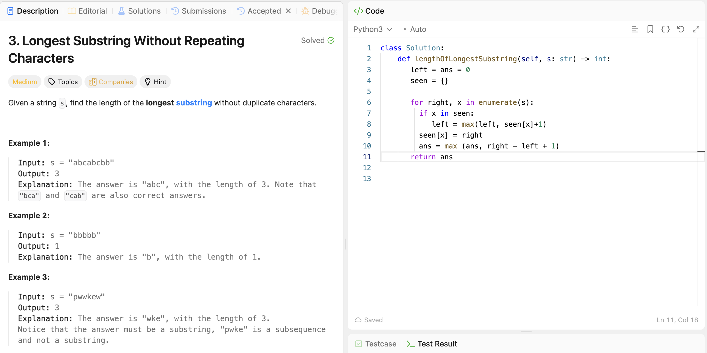

# 3. Longest Substring Without Repeating Characters

**刷题日期**: 2026-10-28

**难度**: Medium

**标签**: Sliding Window, Hash Table

## 题目截图


## 代码

```python
class Solution:
    def lengthOfLongestSubstring(self, s: str) -> int:
        seen = {}       # 字符 -> 最后出现的下标
        left = ans = 0  # left: 窗口左边界
        for right, x in enumerate(s):
            if x in seen:
                # 跳到上一个 x 的下一位；取 max 防止 left 往回退
                left = max(seen[x] + 1, left)
            seen[x] = right                   # 更新 x 最后出现的位置
            ans = max(ans, right - left + 1)  # 当前窗口长度
        return ans
```

## 解题心得

- `seen` 存的是**下标**，遇到重复字符时 `left` 直接跳到 `seen[x] + 1`
- 要取 `max`，是因为 `seen[x]` 可能是窗口外的旧记录，不取 max 的话 `left` 会往回退
- 反例 `"abba"`：最后遇到 `a` 时 `seen['a'] = 0`，不加 max 会让 `left` 从 2 退回 1，窗口变成 `"bba"`，结果就错了
