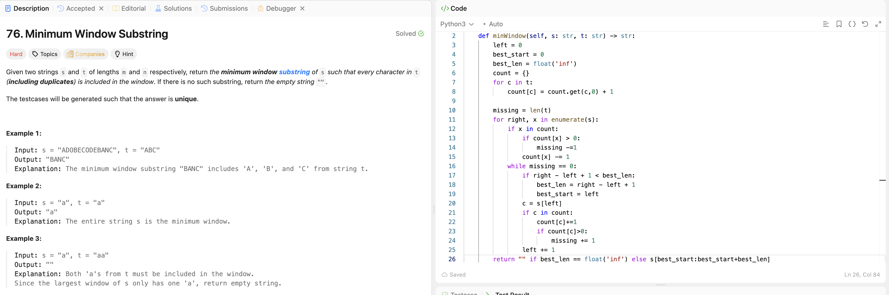

# 76. Minimum Window Substring

**刷题日期**: 2026-10-28

**难度**: Hard

**标签**: Hash Table, String, Sliding Window

## 题目截图



## 代码

```python
class Solution:
    def minWindow(self, s: str, t: str) -> str:
        count = {}                      # count[c] = 窗口里还缺几个 c（负数 = 多余）
        for c in t:
            count[c] = count.get(c, 0) + 1
        missing = len(t)                # 总共还缺几个字符
        left = 0
        best_len, best_start = float('inf'), 0

        for right, x in enumerate(s):
            if x in count:
                if count[x] > 0:        # 真正需要的字符才减 missing
                    missing -= 1
                count[x] -= 1           # 不管够不够都减，允许变负

            while missing == 0:         # 窗口合法 → 一直 shrink
                if right - left + 1 < best_len:
                    best_len, best_start = right - left + 1, left
                c = s[left]
                if c in count:
                    count[c] += 1       #count如果本来是-1，现在变成0→窗口合法
                    if count[c] > 0:    #但如果现在count>0,证明扔掉的是必需字符 → 窗口不合法，停
                        missing += 1    #把缺的字符加上，跳出while loop，右指针继续往右。
                left += 1

        return "" if best_len == float('inf') else s[best_start:best_start + best_len]
```
## 解题思路
1. `count`记t里每个字符要几个，`missing = len(t)`记录总共还缺几个字符
2. 左指针 - 当前窗口的起点，一直在动 - 所以需要用`best_start`来存“目前见过最短的窗口”的起点，然后`best_len`来存窗口长短。
3. For loop(往右走)，如果值在`count`里，`count[x] > 0`：那么`missing -= 1`，因为少了一个要找的字符。
4. 当`missing==0`时(左到右能完全覆盖t)，算当前窗口的长度，如果比`best_len`短就更新`best_len`。然后开始尽量右移左指针来缩小窗口。
5. 右移的同时，如果扔掉的是必须字符，`count[x]=+1`。 如果`count[x]>0`，现在还缺字符 `missing += 1`，窗口已经不合法。停止shrink，进入for loop循环。
6. 直到`right`走到s的末尾。如果`best_len`还是无穷大，返回“”；否则返回`s[best_start : best_start + best_len]`。

## 复杂度

- **时间**: O(m + n)，建 count 是 O(n)，left 和 right 都只往右走，s 里每个字符最多访问两次
- **空间**: O(n)，count 只存 t 里的字符
## 解题心得

- 卡在 shrink：`while missing == 0` 时一直右移 left，每次先记录答案再移出 `s[left]`；移出后 `count[c] > 0` 说明扔了必需字符，窗口失效，跳出 while。
- `count` 一定要允许变负：负数记录“多余”的字符，shrink 时才能区分扔掉的是多余的还是必需的。例：s=`"AAB"`, t=`"AB"`，第一个 A 是多余的，可以扔。
- **shrink靠count来判断扔掉的字符是多余的还是必需的。`missing`只负责判断窗口是否合法。**
- 为什么要存 `best_start` / `best_len`：`left` 是**当前**窗口的起点，一直在动；循环结束时它早已不在最短窗口的位置（例：`"ADOBECODEBANC"` 最后 left=10，但答案 `BANC` 从 9 开始）。所以每次遇到更短的合法窗口就“拍照”存下起点和长度；`best_len` 同时用来比较新窗口是否更短。只存两个整数、最后切一次字符串，比每次 `s[left:right+1]` 省时间，避免 TLE。
- 用 `missing` 一个整数判断窗口是否合法，不用每次遍历 count，保证 O(m + n)。
- 坑：区分大小写，别用 `.lower()`；记录 start + len，最后只切一次字符串，避免 TLE/MLE。

